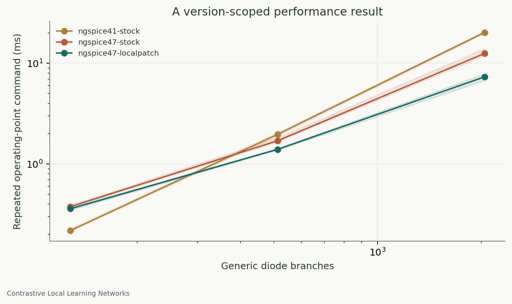

# Contrastive Local Learning Networks

Simulation methods, verification studies, and reusable agent skills from the Contrastive Local Learning Networks (CLLNs) project.



## Read the results

1. [Repeated SPICE analysis](docs/case-studies/01-simulation-performance.md): compare process batching and a version-scoped simulator patch while checking numerical agreement.
2. [Device-table and terminal-current validity](docs/case-studies/02-model-validity.md): measure interpolation errors and account for all device terminals on 1,610 generic device points.
3. [Circuit verification beyond a truth table](docs/case-studies/03-circuit-verification.md): an unloaded XOR pass can conceal loaded failure and input-current demands; a separate latch shows state dependence.

Each note is supplied as Markdown and PDF. Open [the offline visual showcase](docs/index.html), inspect [the validation record](docs/validation.md), or use [AGENTS.md](AGENTS.md) to navigate the repository efficiently.

The public measurements were generated for this release on fresh generic circuits. The underlying research motivated these studies; the original learning architectures, trained weights, scientific findings, and private benchmark graphs are separate. These notes report bounded simulation findings, not new circuit topologies or fabricated hardware.

## Run it

Python 3.10 or later. The core runner uses only the standard library. Install ngspice separately and make its executable available on PATH.

```bash
python -m unittest discover -s tests -v
python -m simcheck demo --out demo-run --require-spice
python -m simcheck studies --out public-run
python -m simcheck verify public-run
python -m simcheck sweep examples/inverter-campaign.json --out campaign-run --workers 2
python -m simcheck sweep examples/inverter-campaign.json --out campaign-run --resume
```

Use fresh output directories for new runs. Resume checks the configuration, netlist, simulator identity, runner source, and hashes of completed artifacts. Changed or corrupt runs are refused. Each simulator job has a timeout and separate process; failures stay in its ledger.

The numerical studies return success when the expected outcomes are observed. The loaded XOR's specification failure is an intended finding, rather than a reason to replace its result with a favorable one. Missing ngspice skips optional core tests; the full studies require it.

## Toolkit

- Run self-contained SPICE circuits in isolated processes with explicit output vectors, timeouts, raw logs, and CSV-like tables.
- Execute declared parameter campaigns with bounded parallelism and verified resume.
- Check voltage/current parity and finite-difference gradient agreement.
- Preserve artifact hashes, source identity, numerical settings, and raw measurements.
- Reproduce device-table audits, gate/load checks, latch transients, and a 45-point inverter corner demonstration.
- Optionally compare shared ngspice libraries in isolated worker processes, using fixed source versions and all-node voltage checks.

[Reproduction details](docs/reproduction.md) cover figure generation and the optional shared-library benchmark. [Method notes](docs/methods.md) explain the introductory numerical checks.

## Six reusable skills

| Skill | Purpose |
|---|---|
| [Solver parity](skills/solver-parity/SKILL.md) | Compare implementations under the same declared physical equations |
| [Implicit gradient audit](skills/implicit-gradient-audit/SKILL.md) | Check derivatives through a converged simulation |
| [Reproducible run record](skills/reproducible-run-record/SKILL.md) | Link the experiment protocol, code, and numerical evidence |
| [SPICE execution and performance](skills/spice-execution-performance/SKILL.md) | Profile and manage repeated simulator workloads |
| [Convergence and stability diagnosis](skills/convergence-stability-diagnosis/SKILL.md) | Investigate failed solves, multiple roots, and transient behavior |
| [Robustness and corner analysis](skills/robustness-corner-analysis/SKILL.md) | Plan and interpret model, supply, temperature, and mismatch sweeps |

Copy a chosen skill folder into a target project's `.claude/skills/` directory after checking that it will not overwrite an existing skill. Each folder includes its license and self-contained instructions. For example, `/solver-parity compare our solver against the reference over the declared domain` invokes the corresponding skill in Claude Code. See [Claude's official skill documentation](https://code.claude.com/docs/en/skills). Other compatible agents can use their own loading mechanism.

The skills have format validation and manual instruction review. A controlled study of their effect on agent performance has not been performed.

## Scope, attribution, and license

The original workflow used Claude with human scientific direction. This collection documents the CLLN project’s simulation and verification workstream.

The ngspice patch is supplied with [upstream attribution](third_party/NOTICE.md), a pinned build recipe, and measured scope. No ngspice binaries or full upstream source tree are redistributed. Our code is BSD-3-Clause; third-party notices remain applicable. See [CONTRIBUTING.md](CONTRIBUTING.md).
