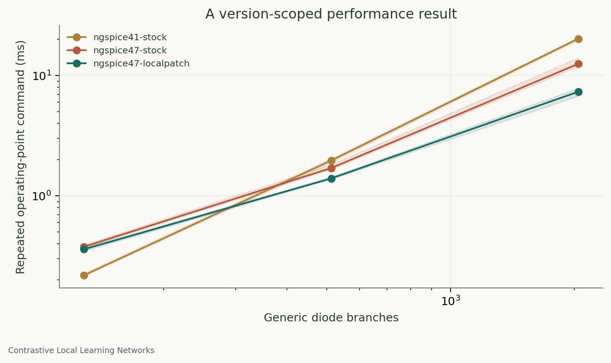

# Repeated SPICE analysis: measure the overhead before changing the physics

Project: Contrastive Local Learning Networks (CLLNs).

A small change to node lookup reduced the median repeated operating-point command time on the tested ngspice 47 diode-bank workloads, with no recorded difference in node voltages between the two ngspice 47 builds. Batching several inputs into one CLI sweep also amortized process-launch overhead. These are two distinct comparisons.

## Research context and public scope

The CLLN project’s simulation work identified repeated simulator setup and teardown as a practical bottleneck and developed execution changes around it. This note reports a fresh replication on generic diode banks. It contains no original learning architecture, classifier result, or private benchmark graph. The earlier internal speedup claim is not used as a performance guarantee here.

## Experiment A: a version-scoped source patch

We built unmodified ngspice 47 and a local variant with the same configuration and compiler environment. The local variant starts device-local node deletion at the saved device-node boundary. Upstream 47 already stops at the first matching node; this patch changes where the lookup begins. The existing upstream guard is preserved. The only changed simulator source file is `src/spicelib/analysis/cktdltn.c`.

Each diode branch has a resistor and a diode with series resistance, which creates an internal simulator node. This deliberately stresses node housekeeping. Each worker performs two warmups, then nine input values. Three independent worker rounds are used, with library order alternating between rounds. Both ngspice 47 arms enable their compiled KLU solver. We compare all saved node voltages at every measured point using 1e-7 V absolute plus 1e-6 relative tolerance.

| Diode branches | Stock 47 median (ms) | Local patch median (ms) | Stock / patched |
|---|---|---|---|
| 128 | 0.378 | 0.360 | 1.05 |
| 512 | 1.704 | 1.398 | 1.22 |
| 2048 | 12.557 | 7.352 | 1.71 |

All paired node comparisons passed. The maximum recorded stock-47 versus patched-47 voltage difference was zero at the 15-digit exported precision. The records also include an installed ngspice 41 build as a historical control; build and solver differences prevent attributing cross-version timing ratios to this patch alone.

## Experiment B: process startup versus a single sweep

For nine input voltages, we separately launched one CLI process per point and compared their total wall time with one CLI DC sweep. The median ratios were 9.52x, 8.03x, and 6.48x at 16, 128, and 512 branches. Every compared output passed the declared voltage tolerance. This timing includes process startup, simulation, and readout. It does not measure the source patch.

## Evidence and reproduction

The shared-library [summary](../../results/shared-benchmark/summary.json), [individual timings](../../results/shared-benchmark/timings.csv), [comparisons](../../results/shared-benchmark/comparisons.csv), and [source/build identity](../../results/shared-benchmark/source-build.json) are included. The CLI [records](../../results/public/performance/timings.csv) retain three repetitions and the raw inputs/outputs. The [patch](../../third_party/ngspice-47-local-node.patch) and [build helper](../../tools/build_benchmark_libraries.sh) target version 47 specifically.

Reproduce the CLI arm with `python -m simcheck studies --out FRESH_DIRECTORY`. For shared timing, follow `docs/reproduction.md`; the optional benchmark runs each library in its own process.

## Limits

Measurements come from one shared host and this chosen circuit family. Timings exclude different work in the two experiments, as stated. Quartile bands are descriptive, not confidence intervals. The patch was checked on these workloads, not every ngspice analysis or device. A DC sweep can follow a different branch in a multistable circuit; agreement here does not make batching universally interchangeable with independent solves.

## Primary references

- [ngspice shared-library interface](https://ngspice.sourceforge.io/shared.html).
- [ngspice control-language tutorial](https://ngspice.sourceforge.io/ngspice-control-language-tutorial.html).
- [ngspice 47 source mirror](https://github.com/imr/ngspice/tree/ngspice-47) and [upstream documentation](https://ngspice.sourceforge.io/docs.html).
