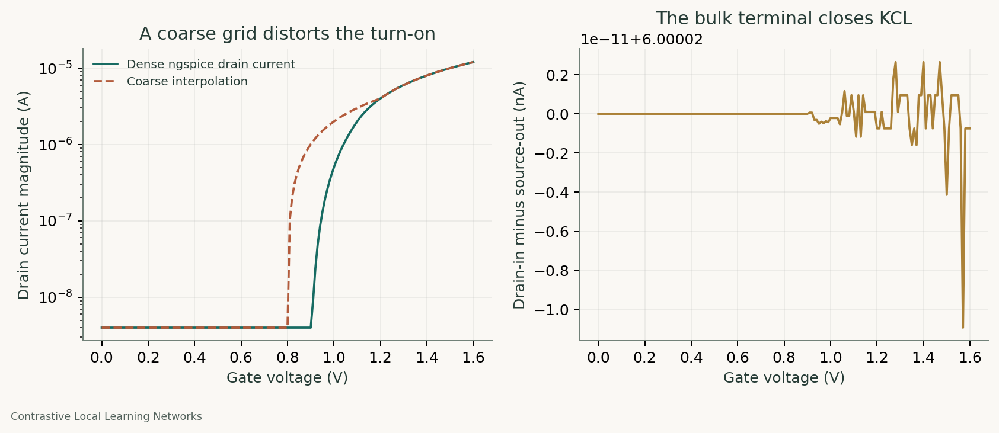

# Device-table agreement and terminal-current consistency

Project: Contrastive Local Learning Networks (CLLNs).

A coarse interpolation grid can distort a device's turn-on, while substituting drain current for source current can violate the intended current balance when a third terminal carries leakage. Our public single-device audit measures both effects and retains the full numerical evidence.

## Research context and public scope

Auditing approximate simulators was a necessary part of the CLLN project. This case study isolates the numerical issues on a newly specified generic Level-1 MOS device. It publishes no research network, optimized device choice, trained parameters, or learning result. The findings are bounded validation results, not claims of a new transistor law.

## Experiment

The public model uses a 0.7 V threshold, 100 microampere-per-volt-squared transconductance parameter, zero body-effect coefficient, and no channel-length modulation. Drain-source voltage is 0.2 V. Source voltage is swept over five values, and the gate is sampled from 0 to 1.6 V in 0.01 V increments. Two simulator junction-conductance settings are tested: 1e-8 S and 1e-12 S. Operating temperature is 27 C.

There are 1610 device points. Separate voltage sources measure drain, source, and bulk currents. We preserve terminal signs and check the sum of all measured terminal currents. For interpolation, the same dense drain-current readings are sampled only at gate voltages 0, 0.4, 0.8, 1.2, and 1.6 V, then linearly interpolated back to the dense grid. No second independent simulator is implied by this interpolation comparison.

## Results

- The largest absolute terminal KCL residual was 1.1e-20 A.
- Drain-in and source-out currents differed by as much as 10.000 nA. The bulk terminal accounts for the difference; the two currents are not interchangeable measurements.
- Coarse interpolation visibly smooths and shifts the turn-on region. The CSV includes absolute errors and relative errors with a declared 1 nA denominator floor. Large relative errors near cutoff should be read alongside absolute current values.

The plot shows one declared slice, source voltage 0.2 V and junction conductance 1e-8 S; all other slices remain in the CSV. A weakly held circuit node can amplify a small current discrepancy, so matching only high-current regimes does not establish a network-wide error bound.

## Evidence and reproduction

The [complete device table](../../results/public/approximation/device-points.csv) includes terminal currents, interpolation values, and errors at every point. The [summary](../../results/public/approximation/summary.json) specifies the grid and model scope. Per-run input netlists, exported simulator tables, and logs are retained in the same directory.

Run `python -m simcheck studies --out FRESH_DIRECTORY`, then regenerate figures with `python tools/render_figures.py` after placing the chosen verified records under `results/public`. The solver-parity and implicit-gradient-audit skills explain how to extend the audit to a target project.

## Limits

This is an illustrative Level-1 model with hard cutoff. It does not establish subthreshold behavior, process calibration, thermal self-heating, or experimental device agreement. The numerical junction conductance is part of the simulator contract, not a measured physical leakage specification. The current table is evaluated against the same simulator that generated its coarse samples; an external reference is still required for an independent model-validity claim.

## Primary references

- [ngspice documentation and device-model manual](https://ngspice.sourceforge.io/docs.html).
- [Public implementation of the experiment](../../simcheck/studies.py).
