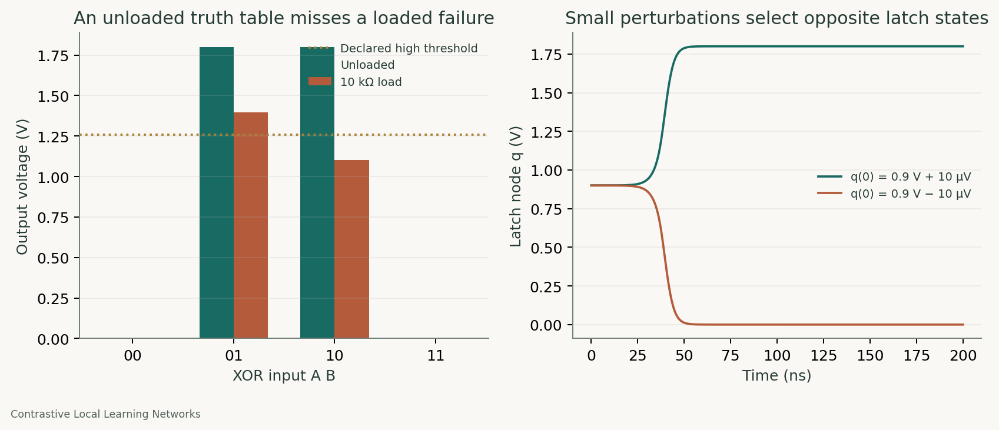

# A truth table does not define a complete circuit specification

Project: Contrastive Local Learning Networks (CLLNs).

A textbook transmission-gate XOR passed all four unloaded input combinations, yet one combination failed the declared high-voltage threshold under a 10 kilohm output load. A separate textbook latch produced distinct operating points and selected opposite final states after small initial perturbations. These examples make two gaps in a DC-only verification procedure directly inspectable.

## Research context and public scope

The CLLN project’s circuit-design work evaluated candidates with checks beyond sampled DC output levels and compared compact candidates with prior art. The public examples here are fresh textbook constructions, not private optimized designs or a release of the search algorithm. We claim no new XOR or latch topology.

## Experiment A: an unloaded pass can conceal a loaded failure

The XOR implements the multiplexer identity `A ? not B : B` using CMOS input inverters and transmission gates. It uses illustrative Level-1 device models, a 1.8 V supply, and ideal input voltage sources. Logic low is at most 0.54 V; logic high is at least 1.26 V. We test the same four input combinations with no resistive load and with a 10 kilohm load to ground.

All four unloaded points passed. Under the load, 3 of four passed: input A=1, B=0 produced approximately 1.102 V, below the 1.26 V high threshold. For A=0, B=1, the loaded output still passed the level threshold, but input B supplied approximately 139.77 microamperes. An ideal input driver can therefore hide a meaningful input-current requirement. That is a failure only if the intended specification excludes or limits this current; pass-transistor circuits are not inherently invalid.

## Experiment B: an operating point need not select a unique stable output

The separate cross-coupled inverter latch is intentionally stateful. Different nodeset guesses found two opposite rail states and a symmetric state near 0.9 V. Transients with explicit capacitances and initial node perturbations of plus/minus 10 microvolts selected opposite rail states. Nodesets guide a DC solver; the initial-condition transients ask a different, physical-dynamics question.

The latch is a counterexample to a uniqueness assumption, not a defective latch or an XOR implementation. The observed transients demonstrate sensitivity of the symmetric point under the stated model and perturbations. We do not claim an exhaustive stability proof.

## Evidence and reproduction

The [XOR table](../../results/public/verification/xor-verification.csv), [latch operating points](../../results/public/verification/latch-operating-points.csv), and [summary](../../results/public/verification/summary.json) link to raw netlists, simulator tables, and logs. Both signed perturbation trajectories are included as CSV files. Run `python -m simcheck studies --out FRESH_DIRECTORY` to reproduce.

## Consequence for verification

Declare loading, input-driver assumptions, voltage thresholds, supply and device corners, and relevant transition histories. Check the corresponding currents and state dependence as well as output levels. The convergence-stability-diagnosis and robustness-corner-analysis skills turn these checks into reusable agent workflows.

## Limits and attribution

These are model-level simulations on generic textbook circuits, with no fabricated-device claim or universal statement about every gate family. A loaded failure at the chosen resistance does not establish failure at every load. The underlying research's prior-art audit included [Becker's published XOR/XNOR designs](https://patents.google.com/patent/US8653857B2/en); the examples in this note are standard mux-XOR and cross-coupled-latch constructions and do not assert equivalence to that patent's specific topology.

The simulator methods follow the [ngspice documentation](https://ngspice.sourceforge.io/docs.html) and [control-language tutorial](https://ngspice.sourceforge.io/ngspice-control-language-tutorial.html).
